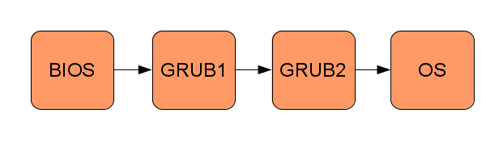
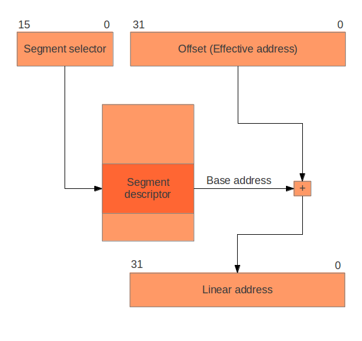
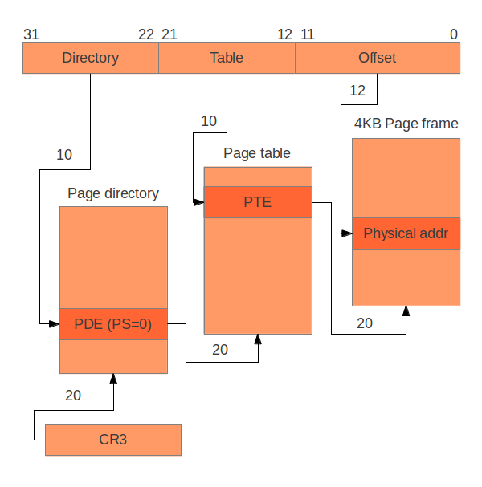

# The little book about OS development — leeswijzer

**Bron:** Helin, E., & Renberg, A. (2015, 19 januari). *The little book about OS development*. Aangeleverde PDF, 78 pagina’s, commit fe83e27dab3c39930354d2dea83f6d4ee2928212.

De volgende hoofdstukbeschrijvingen zijn samenvattingen. De volledige, niet ingekorte paginatranscriptie staat in [corpus/boek.md](corpus/boek.md), met bron-ID’s B001 tot en met B078. De oorspronkelijke PDF blijft in [assets/book.pdf](../assets/book.pdf) beschikbaar voor typografie, tabellen, exacte codeweergave en afbeeldingen.

## 1. Introduction — pagina 7–10

Het boek presenteert zich als een praktische gids voor het maken van een eigen x86-besturingssysteem en niet als volledig theoretisch OS-handboek. De eerste hoofdstukken zijn expliciet; latere hoofdstukken laten meer ontwerpwerk aan de lezer. De auteurs beschrijven incrementele ontwikkeling, handmatig testen na kleine stappen en hun ervaring met samenwerken aan code. De voorkennis omvat C, systeemprogrammering en een UNIX-achtige ontwikkelomgeving. Broncredits, projectinformatie en licentie zijn in dit hoofdstuk opgenomen.

Volledige bron: [B007](corpus/boek.md#b007) t/m [B010](corpus/boek.md#b010).

## 2. First Steps — pagina 11–18

De ontwikkelomgeving bestaat in het voorbeeld uit C/GCC, NASM, Make en Bochs. Het hoofdstuk onderscheidt BIOS, bootloader en kernel. GRUB laadt een ELF-kernel die een Multiboot-header bevat. Het eerste programma zet een herkenbare waarde in een register. Een linkerscript bepaalt entrypoint, secties en plaatsing; daarna wordt een opstartbaar ISO-image samengesteld. De controle bestaat uit opstarten in de emulator en het bekijken van de registerwaarde in de log. De specifieke pakketten, paden en GRUB Legacy-procedure horen bij de beschreven omgeving.

Volledige bron: [B011](corpus/boek.md#b011) t/m [B018](corpus/boek.md#b018).

## 3. Getting to C — pagina 19–22

Voordat C-code wordt aangeroepen moet een stack beschikbaar zijn. Het voorbeeld reserveert die in de bss-sectie en stelt de stackpointer in. Het hoofdstuk licht de cdecl-aanroepconventie toe, behandelt packed structs voor hardwarelay-outs en geeft compiler- en linkeropties voor een omgeving zonder beschikbare standaardbibliotheek. Een Makefile verbindt compileren, linken, ISO-opbouw en het starten van Bochs. De volledige voorbeeldcode staat ongewijzigd bij de bronpagina’s.

Volledige bron: [B019](corpus/boek.md#b019) t/m [B022](corpus/boek.md#b022).

## 4. Output — pagina 23–32

Uitvoer wordt opgebouwd via memory-mapped I/O en I/O-poorten. Het hoofdstuk behandelt VGA-tekstcellen, kleuren, cursorpositie en wrappers voor in- en out-instructies. Daarna volgen seriële-poortconfiguratie, baudrate, line control, FIFO’s, modem control en het versturen van data. De seriële uitvoer wordt in Bochs naar een bestand geleid. Als interface worden schrijffuncties en later printf-achtige uitvoer met logniveaus voorgesteld. Dit vormt tegelijk de eerste kennismaking met een driver als abstractielaag.

Volledige bron: [B023](corpus/boek.md#b023) t/m [B032](corpus/boek.md#b032).

## 5. Segmentation — pagina 33–38

Een logisch adres wordt beschreven met segmentselector en offset. Een descriptor levert basisadres en limiet, waarna een lineair adres ontstaat. Het hoofdstuk behandelt segmentregisters, de GDT, segmenttypen en privilegelevels. Voor het minimale voorbeeld worden overlappende code- en datasegmenten gebruikt; segmentatie dient daar vooral voor privilegeonderscheid. Het laden van de descriptortabel en het vernieuwen van segmentregisters en CS wordt besproken. Figuur 5.1 op pagina 34 is afzonderlijk beschreven en als oorspronkelijke afbeelding bewaard.

Volledige bron: [B033](corpus/boek.md#b033) t/m [B038](corpus/boek.md#b038).

## 6. Interrupts and Input — pagina 39–46

Het hoofdstuk onderscheidt hardware-interrupts, processor-exceptions en software-interrupts. De IDT koppelt een interruptnummer aan een handler. Er is aandacht voor de door de processor op de stack gezette toestand, foutcodes, het bewaren van registers, een gemeenschappelijke handler en het terugkeren uit de interrupt. Daarna volgen PIC-configuratie, remapping en acknowledgement, en het lezen van toetsenbordscancodes. De voorbeelden blijven bronvoorbeelden en zijn in deze kennisbank niet gecompileerd of als foutloos gecertificeerd.

Volledige bron: [B039](corpus/boek.md#b039) t/m [B046](corpus/boek.md#b046).

## 7. The Road to User Mode — pagina 47–50

GRUB-modules maken het mogelijk een extern programma in geheugen te laden zonder eerst een opslagdriver en bestandssysteem te bouwen. De module-informatie wordt via de Multiboot-gegevens doorgegeven aan de kernel. Het hoofdstuk laat zien hoe een klein flat-binaryprogramma wordt gemaakt en gestart. Het benadrukt dat dit programma in deze fase nog op hetzelfde privilegeniveau als de kernel draait; het kunnen laden van een programma is nog niet hetzelfde als geïsoleerde gebruikersruimte.

Volledige bron: [B047](corpus/boek.md#b047) t/m [B050](corpus/boek.md#b050).

## 8. A Short Introduction to Virtual Memory — pagina 51–52

Virtueel geheugen wordt geïntroduceerd als abstractie voor geheugenadressering, procesisolatie en het omgaan met beschikbaar fysiek geheugen. De tekst vergelijkt segmentatie met paging en bespreekt het probleem van aaneengesloten fysieke allocatie, groei en fragmentatie. Het hoofdstuk wijst erop dat de rol van segmentatie in x86-64 sterk verschilt. De eigenlijke pagingimplementatie volgt pas in het volgende hoofdstuk.

Volledige bron: [B051](corpus/boek.md#b051) t/m [B052](corpus/boek.md#b052).

## 9. Paging — pagina 53–60

Voor het beschreven 32-bitmodel worden directory, paginatabel en frame van elkaar onderscheiden. Het hoofdstuk behandelt tabelindeling, adresopdeling, uitlijning, toegangsrechten, identity mapping, het activeren van paging en TLB-gerelateerde handelingen. Daarna wordt de kernel naar een higher-halfadresruimte verplaatst met verschillende virtuele en fysieke plaatsing. Het bootstrapgedeelte moet daarbij kunnen blijven uitvoeren terwijl de vertaling verandert. Ook gevolgen voor framebufferadressen en bootinformatie komen aan bod. Figuur 9.1 en de volledige scripts blijven bij de bron beschikbaar.

Volledige bron: [B053](corpus/boek.md#b053) t/m [B060](corpus/boek.md#b060).

## 10. Page Frame Allocation — pagina 61–64

De frameallocator administreert welke fysieke pagina’s beschikbaar of bezet zijn. Het boek gebruikt de door de bootloader verstrekte geheugeninformatie en bespreekt het reserveren van kernelgeheugen en geladen modules. Linkersymbolen geven de begrenzing van de kernel aan. Voor de administratie worden onder andere bitmaps genoemd. Een nieuwe fysieke pagina is niet vanzelf via een bruikbaar virtueel adres bereikbaar; tijdelijke mappings doorbreken de afhankelijkheid tussen nieuwe paginatabellen en het kunnen beschrijven daarvan. Een kernelheap wordt daarna bovenop de frameallocator geplaatst.

Volledige bron: [B061](corpus/boek.md#b061) t/m [B064](corpus/boek.md#b064).

## 11. User Mode — pagina 65–68

Het hoofdstuk voegt gebruikerssegmenten toe en legt uit waarom segmentselectors alleen niet voldoende zijn om kernelgeheugen af te schermen. Code, data, gebruikersstack en paginatabellen worden voor een gebruikersproces voorbereid. De overgang wordt in het voorbeeld geconstrueerd met een terugkeerframe. Ook entrypoints voor C-programma’s, flat binaries versus ELF en de eerste stappen naar een C-bibliotheek worden behandeld. De precieze adressen, selectors en codevoorbeelden zijn die van de beschreven 32-bitopzet.

Volledige bron: [B065](corpus/boek.md#b065) t/m [B068](corpus/boek.md#b068).

## 12. File Systems — pagina 69–70

Een read-only-RAM-bestandssysteem wordt opgebouwd als data met metadata, samengesteld op de ontwikkelmachine. Bestanden en directories krijgen beschrijvende structuren; de eenvoud heeft beperkingen voor wijzigbare bestanden. Daarna introduceert de tekst inodes voor schrijfbare systemen en een VFS als abstractie boven concrete bestandssystemen. Er worden verschillende manieren genoemd om devices via die laag beschikbaar te maken. Het hoofdstuk is richtinggevend en geen volledige uitwerking van een crashbestendig bestandssysteem.

Volledige bron: [B069](corpus/boek.md#b069) t/m [B070](corpus/boek.md#b070).

## 13. System Calls — pagina 71–72

Systeemaanroepen vormen de interface waarmee gebruikersprogramma’s diensten van de kernel vragen. Het hoofdstuk bespreekt API-ontwerp en een implementatie met software-interrupts. Bij een privilegeovergang is een geschikte kernelstack nodig; hiervoor wordt in het voorbeeld een TSS met bijbehorende descriptor gebruikt. De tekst verwijst naar verdere processorhandleidingen en syscallvoorbeelden. De kennisbank bewaart de beschreven API-keuzes zonder ze als verplichte interface voor Nieuw OS te behandelen.

Volledige bron: [B071](corpus/boek.md#b071) t/m [B072](corpus/boek.md#b072).

## 14. Multitasking — pagina 73–76

De bron maakt onderscheid tussen uitvoering op meerdere processors en snel afwisselen op één processor, en kiest voor het laatste. Eerst worden procescreatie en coöperatieve scheduling met yield besproken. Vervolgens leidt een timerinterrupt tot preëmptieve scheduling. Registers en andere procescontext moeten bij de wissel worden bewaard en hersteld. Afzonderlijke kernelstacks en verschillen tussen onderbreken in kernelmodus en gebruikersmodus zijn belangrijke punten. Dit hoofdstuk behandelt geen volledig multiprocessorontwerp.

Volledige bron: [B073](corpus/boek.md#b073) t/m [B076](corpus/boek.md#b076).

## Bibliografie — pagina 77–78

De oorspronkelijke referentielijst is volledig opgenomen als [B077](corpus/boek.md#b077) en [B078](corpus/boek.md#b078). Een daarin genoemd extern document is niet automatisch in deze kennisbank opgenomen.

## De drie afbeeldingen

### Pagina 12

Figuur 2.1 — Example of the boot process. De vier blokken en pijlen luiden letterlijk: BIOS → GRUB1 → GRUB2 → OS. Het bijschrift zegt dat ieder blok een programma is. Dit beschrijft het bootvoorbeeld van de bron; de labels worden niet hernoemd of gelijkgesteld aan een andere bootroute.

### Pagina 34

Figuur 5.1 — Translation of logical addresses to linear addresses. Bovenaan staan een 16-bit Segment selector (bits 15–0) en een 32-bit Offset (Effective address) (bits 31–0). De selector wijst naar een Segment descriptor. Het Base address uit die descriptor en de offset gaan naar een optelsymbool. De uitvoer is een 32-bit Linear address (bits 31–0). Deze beschrijving volgt de zichtbare figuur; de controles uit de lopende tekst zijn geen extra getekende blokken.

### Pagina 54

Figuur 9.1 — Translating virtual addresses (linear addresses) to physical addresses. Een 32-bit adres is opgedeeld in Directory (bits 31–22; 10 bits), Table (bits 21–12; 10 bits) en Offset (bits 11–0; 12 bits). CR3 wijst met een 20-bit adresdeel naar de Page directory. De directoryindex selecteert een PDE (PS=0); een 20-bit adresdeel wijst naar de Page table. De table-index selecteert de PTE. Het 20-bit adresdeel uit de PTE en de 12-bit offset bepalen de positie Physical addr binnen het afgebeelde 4KB Page frame. De pagina bespreekt daarnaast 4 MB-pagina’s; de tekening zelf toont het pad met PDE PS=0 en een aparte paginatabel.

