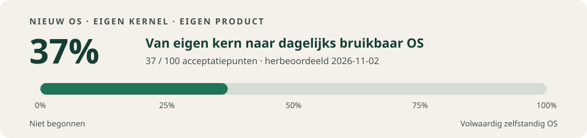

# Nieuw OS — eigen kernel, sessieroute en bureaublad

## Project in het kort

Nieuw OS is een onderzoeksproject voor een zelfstandig besturingssysteem met
een eigen x86_64-kernel en een eigen productervaring rond documenten en
collecties: **Materiaal**. Het is geen Linux-distributie en gebruikt geen
bestaande OS-kernel als basis. Veiligheid en privacy steunen onder meer op
geïsoleerde processen, expliciete capabilities (kernel-afgedwongen rechten)
en begrensde IPC (interprocescommunicatie).

De boot- en runtimeketen is **UEFI/OVMF → eigen Rust-loader → bootprotocol →
`no_std`-Rust-kernel → geïsoleerde processen en diensten → SDK en apps**.
De workspace bevat daarnaast aparte crates voor kernel-/capabilitylogica,
drivers en diensten voor opslag, invoer en netwerk, plus de SDK en native
apps. Rust/Cargo is de hoofdstack (toolchain 1.90.0); Python verzorgt veel
build- en testharnassen. QEMU/OVMF wordt gebruikt voor geïsoleerde VM-proeven.
NAS- en quantumsimulatorprototypes zijn afzonderlijke sporen, geen bewijs van
volledig geïntegreerde native functies.

**Codeleesroute:** begin bij `boot/loader/src/main.rs`, volg naar
`kernel/src/main.rs` en daarna `kernel/src/m2.rs` en `kernel/src/m2/m3.rs`.
Lees voor procesrechten `crates/capability-core/`, voor apps
`sdk/runtime/README.md` en `sdk/examples/materiaal/README.md`. De actuele
status en open gates staan in [PROJECT-STATE.md](docs/PROJECT-STATE.md);
architectuurkeuzes en contracten staan in
[KERNEL-AND-SECURITY-CONTRACT.md](docs/implementation/KERNEL-AND-SECURITY-CONTRACT.md)
en de volledige acceptatieopdracht in
[FULL-TEST-RELEASE.md](docs/FULL-TEST-RELEASE.md). Proeven en builds zijn
geen bewijs van een complete release of ondersteuning van fysieke hardware.

<!-- OS-PROGRESS:BEGIN -->
## Voortgang naar een volwaardig zelfstandig OS



**41% — 41 van 100 gewogen acceptatiepunten.** Dit is een
planningsmeter voor aantoonbaar werkende functies van het eigen OS, geen
percentage verstreken ontwikkeltijd, veiligheidswaarborg of gemeten gelijkheid
met Windows, macOS of Linux. De eigen kernel blijft het fundament; geen van
die besturingssystemen is de basis.

**0%:** nog geen criterium gerealiseerd. **100%:** een volwaardig, dagelijks
bruikbaar en onderhoudbaar zelfstandig OS op gedocumenteerde ondersteunde
hardware, met native Materiaal, nuttige apps, internet, veilige opslag,
updates, herstel en de afgesproken privacyfuncties. Een bootende demo of
alleen een nette desktop haalt die eindgrens niet.

| Productspoor | Totaal punten | Behaald |
|---|---:|---:|
| Eigen kern en procesisolatie | 15 | 13 |
| Opslag en gegevensherstel | 15 | 13 |
| Hardware, drivers en energie | 12 | 1 |
| Native Materiaal en toegankelijkheid | 15 | 4 |
| Internet en netwerkdiensten | 10 | 3 |
| Beveiliging, privacy en updates | 12 | 4 |
| Apps, SDK en installatie | 8 | 2 |
| Persoonlijke NAS en meerdere apparaten | 5 | 0 |
| Lokale AI en quantum-runtime | 3 | 1 |
| Dagelijks gebruik en onderhoudbare release | 5 | 0 |
| **Totaal** | **100** | **41** |

**Herbeoordeeld:** 2026-11-06 · **Rubric:** v1 ·
**Bron:** [`efe75124`](https://github.com/simonvanieperen/nieuw-os/commit/efe7512459efc144a42bcc54b8a27c369311ff70) ·
**Ontwikkelbranch:** `feat/k06-5d2-ring3-smp`.
Deze opdracht: **41% → 41% (+0 procentpunt)**. **Opdracht:** K06 stap 5d-2a: M3-ring-3-processen op elke online CPU (ADR-081), met F5/F7 in de stapel.
41/100 blijft 41/100. In het nieuwe profiel native-smp-m3 draait het basis-M3-manifest (16 ring-3-processen) verdeeld over alle online CPU's: home bij spawn, current per CPU, entry onder KERNEL, kernelronde vóór vrijgeven en stop-the-world. Native lokaal: SMP 37/37 over 29 profielen (M3 op 2/4/8 vCPU's en een AP2-appfault die alleen dat proces stopt), M2/M3, K05, K07, rtc, IPC-wait, FPU en gate.sh groen. K06 blijft open: FPU-canary, IPC over CPU's, usercopy onder ASPACE, K05 op SMP en de §9-matrix (09) ontbreken; de SMP:CLOCK-zelftest is onder TCG timinggevoelig, ook op de basis.

De meter geldt voor de beoordeelde ontwikkelstand; opname in `main` en een
productrelease zijn afzonderlijke gebeurtenissen. Hostprototypes van Materiaal,
NAS/TLS en qsim staan zichtbaar in de projectstatus, maar krijgen geen native
productpunten. Elk criterium telt volledig of niet; onbewezen werk blijft open.

[Criteria, bewijs en berekening](docs/PROGRESS.md) ·
[Volledige roadmap](docs/ROADMAP.md) ·
[Volledige releaseopdracht en acceptatie](docs/FULL-TEST-RELEASE.md) ·
[Actuele uitvoering](docs/PROJECT-STATE.md).
Bij **iedere opdracht** worden deze meter, datum, bewijs en wijziging opnieuw
beoordeeld; de score mag gelijk blijven of dalen. Instructie: [AGENTS.md](AGENTS.md).
<!-- OS-PROGRESS:END -->

Volledige repository-inventaris: [OS-completeness-audit](docs/audit/os-completeness/README.md).
Driververgelijking en voorstel: [OS-repositories en hardwaredrivers](docs/research/2026-11-03/os-repos-and-hardware-drivers.md).

## Historische geïntegreerde bronstand — 3 november 2026

De bron was [`380111b`](https://github.com/simonvanieperen/nieuw-os/commit/380111b68688c981eec6abb8fab29174a29f5601):
de volledige PR126-inhoud en PR127-reviewherstellingen zijn hierin op `main`
gecombineerd. Alle **28 exacte-head GitHub-checkruns** zijn geslaagd.
De [native venstersessie](https://github.com/simonvanieperen/nieuw-os/actions/runs/41535553113)
en de [native netwerkdienst](https://github.com/simonvanieperen/nieuw-os/actions/runs/41535553158)
hebben afzonderlijke QEMU-gates; het netwerk gebruikt een gecontroleerde
synthetische peer.

Dit vervangt geen fysieke hardwaretest, Windows-gasttest of volledige
testrelease. De voortgang blijft **41/100**; deze status- en
API-documentatieaanpassing levert geen productpunten op.

## Native venstersessie — 2 november 2026

[PR #122](https://github.com/simonvanieperen/nieuw-os/pull/122) bevat een eigen
1280×720-desktop met proportionele letters, twee geïsoleerde vensters, focus,
slepen, dock en aanwijzer. Materiaal en Rekenmachine behouden document en
berekening bij een echte compositorcrash. De volledige native route met
opslaan, heropenen en onafhankelijke schijfcontrole slaagt; **U01 is geaccepteerd**.

[PR #123](https://github.com/simonvanieperen/nieuw-os/pull/123) is hierin
geïntegreerd: vier GUI-processen wachten bij afwezig werk. In drie metingen
per variant op één Windows/WHPX-pc daalt de mediane QEMU-procesCPU van 99,37%
naar 11,67% van één logische processor (88,26% lager). Alle 18 CI-workflows op de
geteste integratiehead slagen. Dit is geen algemene latency- of energiegarantie.

```sh
python3 -B tools/build.py --kernel-feature native-window-session
```

De roadmap steeg van 34 naar 41 door N01 en U01. U02, bredere klemborddekking, echte
accountauthenticatie en de volledige testrelease blijven open.
[U01-acceptatie](docs/verification/mature-session-20261102/U01-ACCEPTANCE.md) ·
[idle-integratie en pakketbewijs](docs/verification/gui-idle-20261102/INTEGRATION.md).

## Native klembord — 2 november 2026

[PR #124](https://github.com/simonvanieperen/nieuw-os/pull/124) is in de
desktopbranch opgenomen. Ctrl+C/Ctrl+V deelt geselecteerde tekst tussen Materiaal
en Rekenmachine; Ctrl+Shift+Delete wist het klembord. Alleen de eigen huidige
invoergebeurtenis en actieve venster geven één gebruik. Een vervallen actie
verandert het document niet; compositorherstel begint met een leeg klembord.

Twee volledige Linux/TCG-routes slagen met alle22fasen,34hostreferenties,
17volledige appbeeldvergelijkingen, echt herstel en onafhankelijke schijfcontrole.
Alle18CI-workflows zijn groen op de geteste bron. De eerste versie ondersteunt
192UTF-8-bytes met zichtbare weigering zonder afkappen. Ruimere capaciteit,
de volledige snelheidscriteria en echte authenticatie blijven open; **41/100**.
[Contract](docs/implementation/NATIVE-CLIPBOARD.md) ·
[Bron, native bewijs en Windows-testpakket](docs/verification/native-clipboard-20261102/README.md).

## Eerdere native sessiepreview — 2 november 2026

[Concept-PR #121](https://github.com/simonvanieperen/nieuw-os/pull/121) voegt
gebruikerskeuze, een herkenbaar aanmeldformulier, een expliciete openbare
VM-gast, taakbalk en lokale programmasearch naar de echte Materiaal-app toe.
De achtstappen-QEMU-proef op `344dc0a` slaagt, inclusief het weigeren en wissen
van persoonlijke testinvoer. Echte authenticatie, sleutelvrijgave en veilige
vergrendeling blijven open; de gast is geen beveiligd gebruikersprofiel.

```sh
python3 -B tools/build.py --kernel-feature native-system-session-preview
```

De Windowsstarter kiest WHPX na een echte QMP-initprobe, met zichtbare
TCG-terugval. Begrensde compositor-/tegelbatches verminderen protocolwerk;
volledige schermopbouw blijft een ontwikkelbeperking. De score bleef bij die eerdere preview 34/100; de actuele meter staat bovenaan.
[Onderzoek/ontwerp](docs/implementation/SESSION-AND-DESKTOP.md) ·
[hardware en snelheid](docs/implementation/VM-HARDWARE-AND-PERFORMANCE.md) ·
[proeven en reproductie](docs/verification/session-desktop-20261102/README.md).

## Schaalbare documentopslag M6e — 26% (28 oktober 2026)

[PR #47](https://github.com/simonvanieperen/nieuw-os/pull/47) voegt het opt-in
profiel `native-volume` toe: een copy-on-write-documentvolume in ring 3 met
documenten tot 64 KiB (gestreamd in stukken van 160 bytes), ruimtehergebruik
zonder recordlimiet, quota per domein, `Full` en crashconsistente vrijgave. De
kernel blijft een generieke blokbroker zonder kennis van het formaat.

Bewijs: 16 hosttests, waaronder een uitputtende crashsimulatie, 7 tests van het
onafhankelijke Python-schijforakel, en zeven echte QEMU-runs. Die runs omvatten
normaal gebruik, koude read-only recovery van exact dezelfde image, twee echte
VM-kills (midden in de inhoudswrites en midden in de tabelwrite) met koude
recovery, en een corrupte image die vóór READY wordt geweigerd.
[M6e-bewijs](docs/verification/M6E-ACCEPTANCE.md).

Rubric v1: **S04 (+3) en S05 (+3)**, **20% → 26%**. Proefgeometrie van 256 KiB
inhoud; geen fysieke schijf-, encryptie- of back-upclaim. GitHub Actions op de
PR-head moet de uitslag nog onafhankelijk herhalen.

## Native integratie A01/S08 — 20% (28 oktober 2026)

[A01 SDK-app, PR #31](https://github.com/simonvanieperen/nieuw-os/pull/31)
is op `main` geïntegreerd: een echt, afzonderlijk gebruikersproces met een
gedocumenteerde app-ABI, begrensde capabilityrechten, normale en geweigerde
verzoeken en volledige opruiming. De brongebonden native CI en resource-gates
zijn geslaagd. [A01-bewijs](docs/verification/A01-ACCEPTANCE.md).

[S08 opslagherstel, PR #34](https://github.com/simonvanieperen/nieuw-os/pull/34)
is geïntegreerd na herstel van een wezenlijk probleem: koude recovery opent
de virtuele schijf nu echt read-only, onderhandelt het virtio-readonly-profiel
en kent alleen blokleesrechten toe. De opslagdienst doet in herstelmodus geen
muterende startup-FLUSH. Alle 13 afzonderlijke native QEMU-proeven en de
geïntegreerde [main-CI](https://github.com/simonvanieperen/nieuw-os/actions/runs/40761772907)
slagen. [S08-bewijs](docs/verification/S08-ACCEPTANCE.md).

De vaste rubric v1 kent nu uitsluitend **A01 (+2) en S08 (+1)** toe:
**17% → 20%**. Dit is geen bewijs voor een al volwaardige desktop, fysieke
schijfgaranties, algemene appcompatibiliteit of een productrelease.

## Eerdere integratie en review (historisch)

[PR #13](https://github.com/simonvanieperen/nieuw-os/pull/13) brengt M6c/M6d,
de actuele main en het [nieuwe Windowsbewijs](docs/verification/M6D-CLOSEOUT.md)
samen. De geschiedenis is zonder codeverlies verbonden. Ook de ontbrekende
qsim-parserfix is opgenomen: positionele JSON-arrays worden geweigerd;
[27 hosttests, rustfmt en Clippy](docs/verification/qsim-request-validation/README.md)
slagen. De actuele review- en squashmergestatus staat in de PR.
De native broninputs blijven gelijk en
de voortgang blijft **14%**.

## Laatste bouwstap: M6d — opslagfouten gecontroleerd afhandelen

De eigen kernel laat onzekere schrijfuitkomsten nu bij de apps aankomen zonder
observerpanic of onterechte bevestiging. Acht foutproeven controleren onder meer
WRITE/FLUSH-fouten, time-outs, descriptorweigering en resetquarantaine. Beide
appdomeinen blijven voortgang maken; na `Unknown` volgen geen nieuwe
blokaanroepen of automatische herhalingen van de onzekere wijziging.

Op bron `88e6c04b` slagen **35 groepen / 31 echte VM-invocaties**, inclusief
14 koude recoveries. De afzonderlijke M6b-regressie slaagt met **18 groepen /
14 VM-invocaties**. Beide bewijsbundels zijn afzonderlijk gecontroleerd; de
normale eindbuild is bytegelijk aan beide normale M6d-gateruns. Dit sluit
criterium S07 en brengt de vaste voortgangsmeter van **13% naar 14%**.

[Acceptatie, commando's en bewijs](docs/verification/M6D-ACCEPTANCE.md) ·
[Vooraf vastgelegd contract](docs/implementation/M6D-IO-UNCERTAINTY.md) ·
[PR #11](https://github.com/simonvanieperen/nieuw-os/pull/11).
Werkbranch: `codex/m6d-io-recovery-roadmap`. Herstel gebruikt nog een nieuwe VM;
automatische dienstherstart in dezelfde sessie is de volgende beperkte stap.
De foutinjecties bewijzen geen fysieke schijffouten of stroomuitval.

## Eerdere bouwstap: M6c — namen en documentcatalogus

De nieuwe native dienst bewaart documentnamen, inventariseert uitsluitend het
eigen appdomein en hernoemt met behoud van inhoud en revisiecontrole. Dit is de
opslaginterface voor de latere Materiaal-integratie. De volledige native gate
slaagt op broncommit `bc4cd104`: **19 controlegroepen / 15 echte VM-invocaties**,
waaronder zes koude recoveries, twee externe onderbrekingen tijdens hernoemen
en één normale M1-boot. De volledige M6b-regressie op dezelfde bron slaagt ook:
**18 groepen / 14 VM-invocaties**. Daarnaast slagen 30 Rust-coretests,
33 M6c-harnastests en 15 afzonderlijke hostproeven van de echte serviceadapter.
[Contract](docs/implementation/M6C-NAMED-CATALOG.md) ·
[Acceptatie en reproduceerroute](docs/verification/M6C-ACCEPTANCE.md) ·
[Actuele projectstatus](docs/PROJECT-STATE.md).

```sh
python3 -B tools/build.py --kernel-feature milestone-m6c
python3 -B tools/run_m6c.py --case normal --smoke
```

Werkbranch: `codex/m6c-named-catalog`, [PR #10](https://github.com/simonvanieperen/nieuw-os/pull/10),
boven op de afgeronde M6b-branch. De proef gebruikt eigen wegwerpimages:
vier objecten, maximaal 128 inhoudsbytes, 32 UTF-8-naambytes en 32 journalrecords.
Bezet v1 wordt zonder schrijven geweigerd. Dit levert native opslaggedrag;
de interactieve desktop, encryptie en native NAS-integratie blijven vervolgstappen.

## Afgeronde basis: M6b

De eigen Rust-kernel heeft nu een native objectdienst in ring 3. Twee geïsoleerde
testapps kunnen via capability-IPC objecten aanmaken, lezen, bijwerken en
verwijderen. De dienst schrijft via echte virtio-I/O; revisies en verwijderrecords
blijven behouden na een koude herstart. Apps krijgen uitsluitend hun eigen
domeinendpoint, geen rechtstreekse blok- of DMA-toegang.

De uitgebreide M6b-gate op broncheckpoint `592dccf` is geslaagd: **22 controlegroepen
en 18 echte VM-invocaties**, inclusief acht koude recoveries en twee externe
QEMU-kills. Twee nieuwe WRITE-/FLUSH-foutproeven controleren dat de dienst
Unknown teruggeeft zonder kernelpanic, valse succesmelding, replay of oude
leesinhoud. Ook 22 Rust-tests en 31 M6b-harnastests slagen. De fouten zijn lokale
statussnapshotinjecties na echte devicecompletion; geen echte defecte backend.
Ruwe uitvoer en hashes: [verification/m6b-storage-errors](docs/verification/m6b-storage-errors/).
Het [eerdere M6b-bewijs](docs/verification/m6b/) is behouden.
Deze afgebakende proef gebruikt vier objecten van maximaal 128 bytes en een
journal van 32 records. M6c hierboven voegt namen toe; ruimtehergebruik, encryptie
en native NAS/desktop volgen als aparte integratiestappen.

```sh
python3 -B tools/build.py --kernel-feature milestone-m6b
python3 -B tools/run_m6b.py --case normal --smoke
```

De runner gebruikt een eigen synthetisch wegwerpvolume en sluit na de
acceptatieproef af. Volledig contract: [M6B-OBJECT-STORAGE.md](docs/implementation/M6B-OBJECT-STORAGE.md).
Voortgang, regressies en resterende grenzen: [PROJECT-STATE.md](docs/PROJECT-STATE.md).

## Nieuwe richting: internet en persoonlijke NAS-opslag

**Vervolg N02:** [hybride TLS-transportproef](services/nas/TRANSPORT.md) met echte wederzijdse authenticatie en X25519MLKEM768 op loopback. De gecontroleerde [beveiligings-/PQC-blauwdruk](docs/implementation/VERIFIABLE-SECURITY-AND-PQC.md) onderscheidt formele eigenschappen, eigen kernel, CHERI-onderzoek en native integratie. Dit is hostbewijs; geen native internetstack, formeel bewezen compleet OS of volledige postkwantumauthenticatie. Uitvoering en actuele testresultaten: [PROJECT-STATE.md](docs/PROJECT-STATE.md).

De gebruikerswijziging van 27 oktober 2026 voegt veilige internettoegang, eigen NAS en gedeelde ruimte bij vrienden/familie toe. Inhoud en documentnamen worden op de gebruikersclient versleuteld; de NAS-beheerder kan ruimte intrekken en zijn kopie verwijderen zonder gebruikerssleutel of toestemming. De uitvoerbare hostproef staat in [services/nas/](services/nas/README.md); het browserprototype blijft een simulatie. Contract en native integratiecriteria: [NAS-SHARING-AND-INTERNET.md](docs/implementation/NAS-SHARING-AND-INTERNET.md). Dit voegt nog geen netwerkstack aan de kernel toe en verandert de M6a-bewijsstatus niet.

De eigen Rust-kernel start via de eigen UEFI-loader in QEMU, draait geïsoleerde gebruikersprocessen en verwerkt capabilities/IPC. M5 voegt een echte ring-3-blokdienst met alleen-lezen virtio-I/O toe. De definitieve M1–M5-suites slagen: **77 controlegroepen en 64 echte VM-runs**, plus een normale M5-eindstart. Materiaal en qsim blijven afzonderlijke hostprototypes. Dit is een experimentele ontwikkelversie met synthetische testprogramma's.

- **Actuele voortgang en open controles:** [PROJECT-STATE.md](docs/PROJECT-STATE.md).
- **Starten en reproduceren:** [DEVELOPMENT.md](docs/DEVELOPMENT.md).
- **Opgeslagen testbewijs:** [docs/verification/](docs/verification/).
- **Productprototype:** [handleiding](ui/prototype/README.md).
- **Quantumsimulator:** [handleiding](experiments/quantum/README.md).

M6b is hervat vanaf `main` (`1f24f99`) op [codex/m6b-storage-errors](https://github.com/simonvanieperen/nieuw-os/tree/codex/m6b-storage-errors). De status staat per spoor in PROJECT-STATE.md. [PR #3](https://github.com/simonvanieperen/nieuw-os/pull/3) bewaart de M5-historie; de oude testmatrix staat in [ACCEPTANCE.md](docs/verification/m5/ACCEPTANCE.md).

De oudere M5-leesproef blijft selecteerbaar via `python tools/build.py --kernel-feature milestone-m5` en `python tools/run.py --smoke --milestone m5`. Er is nog geen interactieve native desktop. Kerneltransport en QEMU-device zijn vertrouwd; geen IOMMU- of fysieke-hardwarebewijs. De uitvoerroute staat in DEVELOPMENT.md. Publieke publicatie en definitieve licentie blijven een afzonderlijk besluit volgens LICENSE-PLAN.md.

## Projectrichting en verder lezen

Nieuw OS bouwt een eigen Rust-kernel met expliciete bevoegdheden en afzonderlijke
systeemdiensten, plus een oorspronkelijke productervaring: **Materiaal**.
Documenten en collecties staan centraal; apps zijn verwisselbare gereedschappen.
De eigen kernel is geen fork van een bestaand besturingssysteem. Rust/LLVM,
QEMU, UEFI, open standaarden en gecontroleerde bibliotheken zijn ontwikkelmiddelen.

Persoonlijke gegevens blijven lokaal, end-to-end versleuteld op een expliciet
gekoppelde persoonlijke NAS, of — na expliciete keuze — als opaque client-side
versleutelde objecten bij een externe opslagprovider. Een provider krijgt geen
Nieuw-OS-inhoudssleutel en is geen stille fallback. Internet vraagt passende
app-/peer-/providerrechten. Systeem-AI blijft op het eigen apparaat zonder
cloudfallback; installatie van een app verleent geen algemene bestands- of
netwerkrechten. Privacykeuzes verruimen alleen expliciete gegevensstromen:
de Security Floor met isolatie en capability-afdwinging blijft actief.
De actuele native implementatiegrenzen staan per spoor hierboven.

- [Architectuur en kernelcontract](docs/implementation/KERNEL-AND-SECURITY-CONTRACT.md).
- [Materiaal en productambitie](docs/implementation/PRODUCT-SPEC.md).
- [Gebruikersbehoeften, overstapbarrières en OS-ontwerptrends — onderzoek 2 november 2026](docs/research/2026-11-02/README.md).
- [Volledige OS-journey: installatie, eerste gebruik, mentale modellen en installer-/onboardingvoorstellen](docs/research/2026-11-02/journey/README.md) — documentonderzoek; geen installer geïmplementeerd.
- [Privacycontract](docs/LOCAL-PRIVACY-CONTRACT.md).
- [Quantumspoor](docs/QUANTUM-RESEARCH.md).
- [Beveiliging en postkwantumroute](docs/implementation/VERIFIABLE-SECURITY-AND-PQC.md).
- [Security Floor en versleutelde object-/provideropslag](docs/implementation/ENCRYPTED-OBJECT-STORAGE.md).
- [Werkinstructies voor agents](AGENTS.md).
- [Ontwerpbesluiten](docs/DECISIONS.md) en [afhankelijkheden](docs/DEPENDENCIES.md).

De startdocumenten van 26 oktober beschrijven de toenmalige voorbereiding.
Zinnen daarin over ontbrekende loader/kernel of niet-uitgevoerde eerste tests
zijn historisch; volg voor de huidige uitvoering PROJECT-STATE.md.
De README en roadmap zijn geen claim van onhackbaarheid, algemene
hardwarecompatibiliteit of reeds bewezen gelijkwaardigheid met bestaande platforms.
