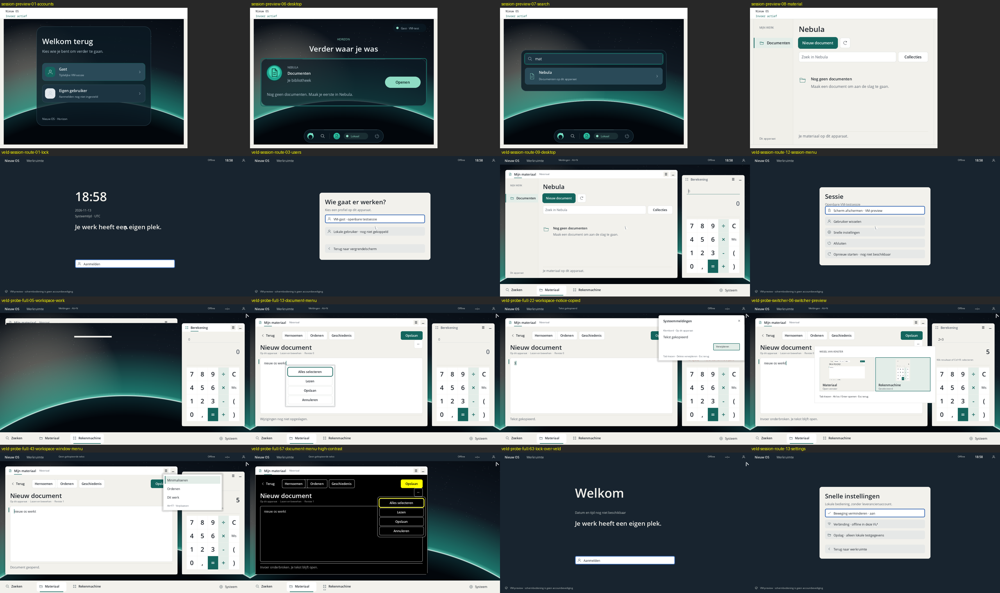

# UI audit, 13 November 2026 (Phase A)

Source: `c76daf7b` on branch `claude/baryon-os-ui-ux-design-152adb`. All frames
below are **native QEMU** screendumps (TCG, q35-10.0, 1 vCPU, 256 MiB, disposable
images), produced by the existing runners without source changes
(`git diff --exit-code` exited 0 afterwards). Commands, exit codes and evidence
levels are in
[docs/verification/design-baseline-20261113/README.md](../verification/design-baseline-20261113/README.md).
Curated frames and hashes: [screenshots/baseline-2026-11-13/](screenshots/baseline-2026-11-13/).

The project owner classified these screens as **functional references, not
visual targets** (13 November 2026). This audit records what works and what
must change; it does not propose evolving the current look.

## 1. What exists natively

| Surface | Route and renderer | Evidence level |
|---|---|---|
| Accounts, sign-in, denied, Horizon home, search, Nebula list (800×600) | `run_session_preview.py`; `ui/native` | App rectangle byte-equal to host oracle; chrome outside it not compared |
| Lock, users, personal/guest auth, hardware unavailable, desktop, search, session menu, quick settings (1280×720) | `run_window_session.py --session-route`; Veld (`sdk/examples/window-session`) | Serial shell state only; no pixel oracle |
| Workspace: editor, document menu, clipboard, notifications, window menu, minimise, move, arrange, high contrast, lock over workspace | `--clipboard --workspace` (CI full gate) | 33 phases compared on full app body; `workspace-*` phases on shell regions only |
| Window switcher (Alt+Tab) | `--switcher --scale 1` | Switcher gate passed |

There are two separate shells: the `ui/native` desktop (Horizon page, Orbit
capsule, Signaal overlay, Nebula page) and the Veld trusted workspace
(header bar, full-width dock, multi-window compositor). They share
`ui/graphics/src/theme.rs` but little else.

## 2. Functional strengths to keep

- Trusted-surface contract works natively: the lock and session pages are an
  opaque cover that never reads app pixels; secrets go through the session
  route; the VM-preview disclaimer is visible.
- Familiar paths exist: Alt+Tab with live previews, window menu with minimise
  and arrange, keyboard window move, notifications panel, quick settings,
  session menu, high-contrast mode with 7:1 roles.
- Storage and capability facts are already in the copy ("Op dit apparaat",
  "Lezen en bewerken", "Revisie 1", read-tool blocked and restored).

## 3. Visual and UX findings

| # | Finding | Frames |
|---|---|---|
| F1 | Two unrelated visual systems: dark glass Horizon with a capsule dock versus navy and cream Veld with a classic full-width taskbar. The taskbar contradicts the 5 November decision against a classic taskbar. | `session-preview-06`, `veld-session-route-09` |
| F2 | Generic cream application windows (`0xf2f1ec`) with bordered button-row toolbars; no window architecture of their own. | `veld-probe-full-13`, `-43` |
| F3 | Weak typography: small Open Sans, many 11–12 px grey hints, flat hierarchy, monospace bitmap strip in the compositor chrome. | all |
| F4 | Dated palette: mineral off-white plus deep green or teal, and a simplistic teal planet-horizon wallpaper. | all |
| F5 | Brand absent or wrong: screens say "Nieuw OS"; no BaryonOS mark; the Zenit "horizon" glyph is unrelated to the logo. | `session-preview-01`, Veld header |
| F6 | Naming collides on screen: "Mijn materiaal", "Nebula", "Materiaal", "Berekening" and "Rekenmachine" name the same two apps. | `veld-session-route-09` |
| F7 | Shell pages look like web forms: cream cards on flat slate with blue outline rings. | `veld-session-route-03`, `-12`, `-13` |
| F8 | Overlap and spacing defects: "Hernoemen" and "Ordenen" overlap; the session-menu subtitle crowds its first row; the error line on hardware-unavailable is 12 px and 14 px from the card edge. | `veld-probe-full-08`, `veld-session-route-12`, `-05` |
| F9 | Guest sign-in still offers fingerprint and FIDO2 buttons that do not apply. | `veld-session-route-08` |
| F10 | The notifications panel covers the editor's primary action. | `veld-probe-full-22` |

## 4. Open items (not confirmed defects)

- In `veld-probe-full-05` and `-06` the unfocused Material window body is not
  painted (wallpaper shows through, with a stray white bar). The gate compares
  only shell regions in these phases, so these pixels are unverified. The cause
  may be a compositor damage defect or a mid-repaint capture. Not investigated
  in this design branch.
- A possible small rectangle under the Rekenmachine dock icon in
  `veld-probe-full-57` was not verified.
- The 200 % profile and the library walkthrough were not captured.
- Clock shows `--:--` in probe frames because only `native-session-route`
  enables the system clock; this is a profile effect, not a defect.

## 5. Consequences for the redesign

The redesign replaces the visual layer entirely (F1–F5, F7) and unifies naming
(F6, see [NAMING-AND-IA.md](NAMING-AND-IA.md)). It keeps the trusted-surface
rules, the familiar interaction paths and the storage/capability facts of §2.
F8–F10 are layout defects in Veld that a native restyle must not carry over.
