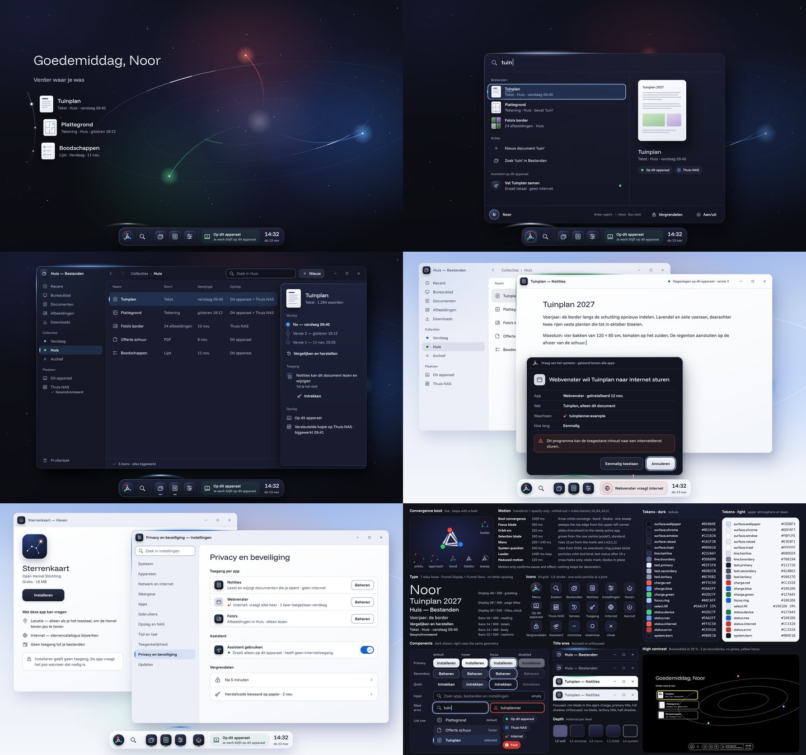
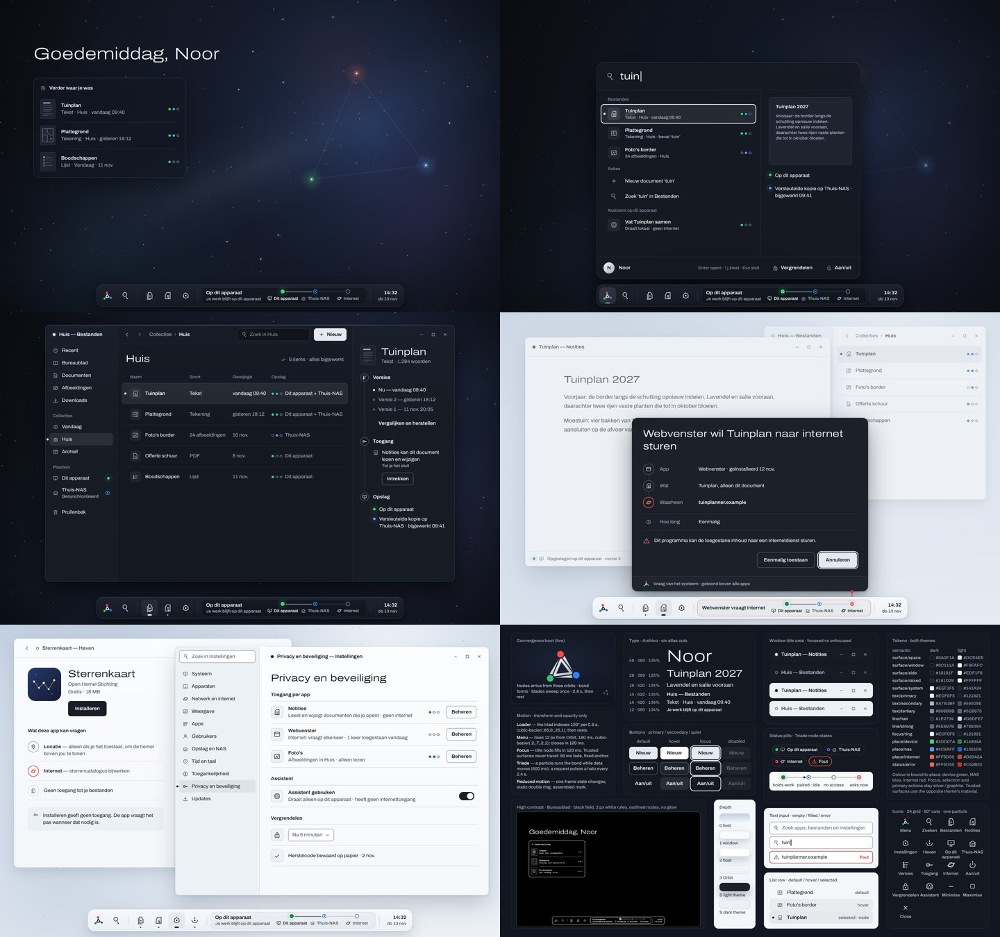
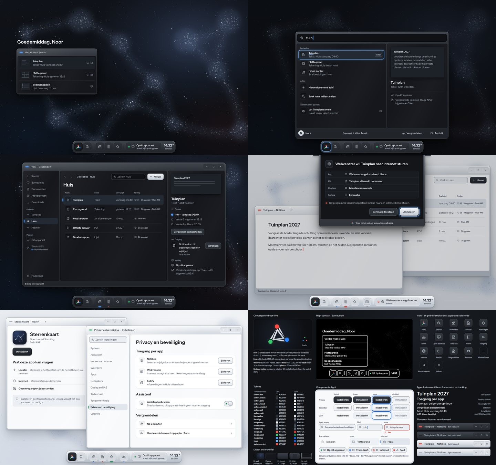

# Visual directions: critique and selection

Phase C of the design pipeline (13 November 2026). Evidence level: **design**.
The boards are static HTML pages rendered in Chrome at 1440 × 900 CSS px,
scale 1. They are not native output, they were not shown to users, and a
board is not evidence of a working OS feature.

## Brief

Three directions were designed independently from the same brief, the same
mark v1 ([BRAND.md](BRAND.md)), the same Dutch content and the same sample
data. Each board has six artboards:

1. Bureaublad (desktop), dark theme
2. Zoeken (launcher) with results and preview
3. Bestanden with inspector
4. Two windows and a trusted system question, light theme
5. Instellingen and Haven, light theme
6. System board: boot convergence, motion, type, icons, tokens for both
   themes, component states, high contrast

The old interface ([AUDIT-2026-11-13.md](AUDIT-2026-11-13.md)) was a
functional reference only; its cream windows, teal accents, planet horizon,
button-row toolbars and cream taskbar were excluded.

| Direction | Signature | Faces on the board |
|---|---|---|
| **Orbitaal** | Orbital light: thin tapered light blades mark focus, selection and the active app; Orbit carries an orbital arc behind the active app; wallpaper "Binding" (dark) and "Dageraad" (light) | Funnel Display, Funnel Sans |
| **Triade** | The mark's three bonded nodes become a live instrument in Orbit (device / Thuis-NAS / internet); the trio recurs as who/what/where rows, inspector timeline and title node; trusted surfaces use the opposite theme's material | Archivo (104 % UI, 125 % identity) |
| **Materie** | Windows as machined chassis with bevelled rims and recessed panes; colour only as emissive points of light; shape-coded place lights; top-hung trusted "vault" | Instrument Sans |

Full boards: `ui/design/concepts/{orbitaal,triade,materie}/index.html`
(served from the repository root, fonts from `ui/design/fonts/`). Sheet
hashes: [concepts/SHA256SUMS](concepts/SHA256SUMS).

## Critique method

One independent reviewer agent scored the three boards against the rubric
fixed before design began. This is AI judgement by a second model, not a
human design review and not user testing; scores are judgements, not
measurements. Items the reviewer measured in the DOM (target sizes, minimum
font size, letter-spacing) and token-pair contrast ratios are reported as
measurements; everything else is judgement.

| Criterion (weight) | Orbitaal | Triade | Materie |
|---|---:|---:|---:|
| Identity and art direction (25) | 8 | 6 | 6.5 |
| Usability (20) | 8 | 8 | 6 |
| Consistency (20) | 8 | 7.5 | 6 |
| Native feasibility (15) | 7 | 8.5 | 6 |
| Accessibility (10) | 7 | 7 | 5.5 |
| Performance (10) | 7.5 | 8.5 | 6 |
| **Weighted total (/100)** | **77.0** | **74.25** | **60.75** |
| Visible generational leap over the old UI | yes | yes | no |
| Light theme as refined as dark | yes | no | no |

Weighted totals were recomputed by the lead from the per-criterion scores.

## Selection

**Orbitaal is selected, conditionally.** It has the strongest identity and is
the only direction whose light theme matches its dark theme. The margin over
Triade (2.75 points) comes almost entirely from identity and art direction;
Triade has the better system semantics and is more feasible natively. The
selected direction is therefore *Orbitaal art direction with Triade semantics
and trusted-surface rules*, delivered as one revision pass (v2), not a
restart. Materie is rejected: its light theme reverts to grey metal windows,
and its condensed 12 px labels are the least legible of the three.

The lead checked artboards 1 and 4 of Orbitaal in Chrome and confirmed the
reviewer's main observations: the Orbit arc floats outside the dock, the
privacy pill carries a teal tint, and the app interiors (Bestanden,
Instellingen) are conventional behind a distinctive frame.

### Adopted from Triade and Materie

- Triade's three-node instrument (Dit apparaat / Thuis-NAS / Internet, each
  with icon and label, a request state tethered to the question) replaces
  Orbitaal's single privacy pill; its connectors are drawn as Orbitaal light
  blades, with a collapsed nodes-only form when Orbit is crowded.
- Trusted surfaces take the opposite theme's material, and a system scrim
  dims all apps while a trusted question is open.
- The question shows bonded who/what/where rows (App, Wat, Waarheen); the
  inspector shows Versies / Toegang / Opslag as a bond timeline.
- Colour means place only: green device, blue NAS, red internet; never
  decoration.
- Materie's shape code for place and state: solid dot device, ring with dot
  NAS, open ring internet, square error, always with icon and text.
- A divider in Orbit separates third-party apps; the focused launcher result
  shows an Enter keycap.

### Must-fix list for Orbitaal v2

1. Dark-theme trusted surface: `#0B0E1B` on window `#12162A` is 1.07:1
   (token pair). Use the inverted material and render a dark-theme question.
2. Remove the teal and mint tint from the privacy indicator.
3. Rebuild the indicator as the shape-coded three-node instrument.
4. Redraw the Haven icon, which reads as a smiley.
5. Keep the Orbit arc inside Orbit's bounds and tie it to the active item.
6. Give desktop continuity items a calm plate, or route orbit lines away from
   text, and verify 4.5:1 against sampled wallpaper pixels.
7. Replace coloured collection dots with icons.
8. Carry the signature into app content (version timeline as a bond,
   selection as a blade, inspector tethered to the selected row) and restyle
   Instellingen away from a conventional settings layout.
9. Use one dock-icon treatment in both themes.
10. Reduce the type system to the native face budget
    ([TYPOGRAPHY.md](TYPOGRAPHY.md) §9).
11. Specify an opaque fallback for the launcher's backdrop blur over windows;
    natively, blur is feasible only over the static pre-blurred wallpaper.

The v2 board is set in the typeface selected in [TYPOGRAPHY.md](TYPOGRAPHY.md);
the Funnel faces on the v1 board were the designer's choice, not a project
decision.

## Orbitaal v2 board

[`ui/design/concepts/orbitaal-v2/index.html`](../../ui/design/concepts/orbitaal-v2/index.html)
applies the selection above: the must-fix list (MF1–MF11), the Triade and
Materie grafts (G1–G8), the `type-1.0` roles with Inter 4.001 (T) and wordmark
v2 on brand surfaces only (W). The v1 page and the Triade and Materie pages
stay unchanged as comparison and regression references. An independent AI
recheck rendered the board at 100 % and 200 %, under reduced motion and with
keyboard focus, sampled contrast from pixels and accepted it with six open
minor findings; the record, generator and renders are in
[docs/verification/orbitaal-v2-20261114](../verification/orbitaal-v2-20261114/README.md).
The board is a static design, not a working OS, and no participant has tested it.

## Not verified

- Layouts at 1280 × 720 were not rendered for any board; only the v2 board was
  rendered at 200 % (device scale factor 2, not a reflow).
- High contrast was judged only from the reduced miniatures on artboard 6.
- Motion and the boot convergence were judged from static frames and written
  specifications; no animation was watched or timed.
- Text contrast over wallpapers and frosted surfaces was not sampled from
  pixels.
- Native feasibility scores are estimates against the renderer facts in
  [NATIVE-FEASIBILITY.md](NATIVE-FEASIBILITY.md), not prototypes.
