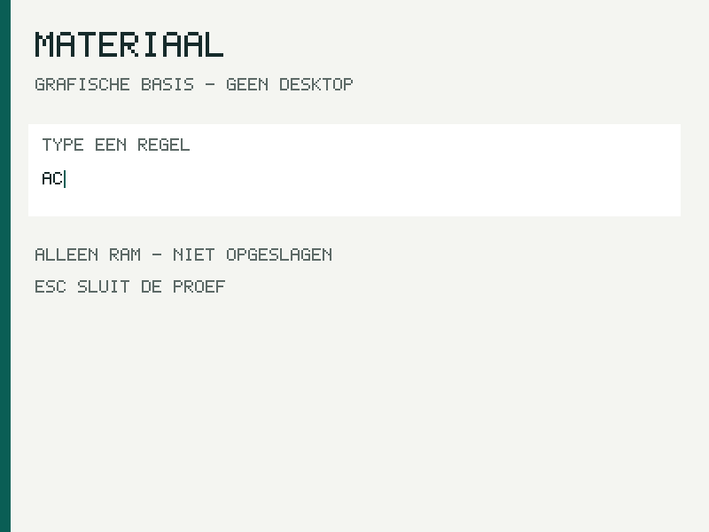

# Parallelle native acceptatie — 28 oktober 2026

## Uitkomst en bron

**80 geaccepteerde echte VM-uitvoeringen op dezelfde gecombineerde bron.**
De vier daadwerkelijk beschikbare agentplaatsen zijn gebruikt: hoofdagent en
drie hergebruikte agents. Onafhankelijke bouwgebieden, eigen Cargo-targets,
VM-processen, wegwerpimages en logmappen voorkwamen gedeelde buildoutput.

Uitvoeringscommit: `3e41bbf93822f7044c6020259f4a752925e1966d`.
Bronfingerprint v3: `307c828e9ce7bf49a4e809859ca77ecd332015572dd37e96fb580de98951aa60`.
Gepubliceerde boom: `91aedd67606edf8870edf2039c2c2aba9dd62e5e`.
Lokale en GitHub-commit waren vóór de lange gates identiek. De bron bleef
onveranderd tijdens de suites. PR #15 bouwt op de behouden PR #14; main391f02e
is daarin al opgenomen. Definitieve review-/mergestatus staat op GitHub.

| Onderdeel | Nieuwe mogelijkheid / gecontroleerd gedrag | Native bewijs |
|---|---|---|
| G0 | Eigen800×600-uitvoer; a/b/backspace/c; iedere toets verandert de begrensde invoerregio; backspace herstelt exact a |1 geaccepteerde verse pipe-VM |
| SDK + catalogus | Bestaande native IPC loopt via nieuwe SDK; schrijven, wijzigen, namen, CAS, verwijderen en lezen na koude herstart |35 groepen,31 VM,14 koude herstelparen |
| M6b-opslag | CRUD/revisies/tombstones, journalfull, corruptie, echte crashcuts, WRITE/FLUSH-onzekerheid, deadlines en resetquarantaine |32 groepen,28 VM,13 koude herstelparen |
| Quantumport | Ongewijzigde qsim-core in twee private userprocessen; Bell/zesqubitreferenties, arena-uitputting, Control-cancel/werkdeadline, cleanup |1 VM, exacte28-regelreeks |
| M3-regressie | Procesisolatie, preëmptie, fault/exit, idle, groteBSS en gewone M1-boot blijven werken |22 groepen,19 VM +3 host/artifactgroepen |

De 80 aanvaarde VM-uitkomsten zijn 76×raw33 en4×raw−9. De vier hostkills horen
bij de expliciete crashproeven en zijn geen onverwachte fouten. Hosttests,
compilaties en opnieuw gelezen bewijs worden niet als extra VM-uitvoering
gerekend. De afzonderlijke suites bevatten ook een gewone M1-regressiestart;
die is al in hun aantallen opgenomen.

## Wat nu werkelijk native werkt

De SDK heeft een allocatorvrije no_std-runtime voor de bestaande ABI en
canonieke IPC. Gewone M6c-clientcommunicatie gebruikt die runtime werkelijk
in ring3. Alle 30 M6c-kernels bevatten exact de SDK-user-ELF
`2ef58d24b7ea8da9a857f58d580b78d65d698779fb2384c7eba524a08963a52d`;
de 31e VM is de gewone M1-regressie. De afzonderlijke generieke catalogusadapter
is met27 runtime-/adapterhosttests en native compilatie gecontroleerd; deze
suite lanceert niet de losse catalog-read-voorbeeldapp.

Een normale catalogusrun bereikt sequence10 met tien mutation-ACKs en twee
levende objecten met revisie3; een afzonderlijke koude VM herstelt dezelfde
bytes zonder nieuwe writes. De volledige poort controleert ook de onzekere
uitkomsten. Een verloren/onzeker resultaat wordt niet als succes voorgesteld
en leidt niet tot automatische mutatieherhaling. De WRITE-timeout-oracle
staat bij een al gepubliceerde descriptor uitsluitend de oude schijf of exact
het eerste bedoelde record toe. In de drie nieuwe native WRITE-timeoutcases
werd sequence0 waargenomen; de sequence1-grens is afzonderlijk hostgetest.

De quantumport gebruikt maximaal6 qubits,64 gates,4096 shots en een 64 KiB-arena
per proces. Beide processen behalen253 checkpoints, gebruiken7216 bytes voor
nuttige buffers en raken daarna de volledige arena gecontroleerd uitgeput.
Er zijn 4 echte timerinterrupts en505 syscall-aanroepen; alle 96 toegewezen
procesframes worden opgeruimd. De kernel bevat uitsluitend een vaste
acceptatieobserver; simulator-, document- en appbeleid blijven gebruikerscode.
Dit is een klassieke simulator op het eigen OS, geen fysieke quantumprocessor.



Dit beeld komt uit de nieuwe QEMU-run. PNG+vastgelegde originele header
reconstrueren het oorspronkelijke PPM exact. De tekstinvoer leeft nog in RAM;
de gekoppelde grafische Materiaal-documenthandeling behoort tot G1.

## Gerichte review en bewijsintegriteit

De geïntegreerde reparaties behandelen QMP-requestidentiteit, gedeelde
read/write-deadlines, volle pipes en langzaam aangeleverde antwoorden;
per-toetsgrafiek en het echte backspacebeeld; expliciete VGA-ROM-provenance;
standalone Rust-targetdetectie; en de gepubliceerde WRITE-timeoutgrens.
De scalarcontrole herkent nu prefixed instructies en weigert onbekende
opcodes. Echte negatieve x87/MMX/SSE/AVX-bytefixtures worden afgewezen,
terwijl het native programma met software-float gelijk blijft werken.

Een onafhankelijke kruisaudit ontdekte dat het oorspronkelijke G0-serialbestand
na de directe archiefkopie was vervangen door een 409-byteprefix zonder de
laatste twee markers. Die oorspronkelijke 425-bytearchiefkopie, de afwijkende
waarneming en het mislukte auditresultaat blijven bewaard. De oorzaak van de
vervanging is niet vastgesteld; er is geen oud artifact gerepareerd. Die run
is uitgesloten. Een verse private pipe-run slaagt en is meerdere keren direct
gehasht, inclusief onafhankelijke PNG→PPM-reconstructie. Een extra UNIX-
socketprobe faalde op sandbox-EPERM en telt evenmin als succes. De geverifieerde
ontwikkelroute in deze omgeving gebruikt pipes.

De hoofdagent heeft alle 80 uiteindelijke VM-mappen en616 werkelijke
artifacthashes opnieuw gecontroleerd. De opslagkruisaudit leest daarnaast
onafhankelijk28 VM's,14 volumes,13 byte-exacte koude koppelingen, canaries,
journalheaders/revisies/payloads en de zeven Unknown/no-ACK/no-replay-paden.
De andere crosscheck bevestigt quantumproces-/heap-/cleanupwaarden en de
nieuwe G0-artifacts. Dit zijn AI-controles, geen onafhankelijke menselijke
audit of formeel correctheidsbewijs.

## Bewijsregister

- [Gecombineerde616-hashaudit](parallel-final-integration/README.md).
- [M6b32/28 + volledige capture](parallel-final-m6b/README.md).
- [SDK/M6c35/31 + volledige capture en ELFbinding](parallel-final-sdk-m6c/README.md).
- [Quantumacceptatie en scalarartifact](parallel-final-qsim/README.md).
- [M3-regressie22/19](parallel-final-m3/README.md).
- [Bevestigde G0-run en screenshots](parallel-final-g0-confirmed/README.md).
- [Oorspronkelijke G0-afwijzing](parallel-final-g0/invalidated.json).
- [Hosttests/native SDK-compilaties](parallel-final-host/checks.json).
- [Onafhankelijke opslagcrosscheck](parallel-final-crosscheck-runtime/README.md).
- [Quantum/G0-crosscheck en oorspronkelijke afwijking](parallel-final-crosscheck-storage/README.md).
- [Gerichte review van de gecombineerde integratiehooks](parallel-final-integration-review/README.md).

Historische agentbewijzen blijven onder parallel-b01..b05, parallel-g01..g04
en parallel-i01..i04 aan hun eigen bronversies gebonden. Nieuwe resultaten
worden niet bij historische aantallen opgeteld. De binaries en diskimages
blijven buiten Git; ruwe tekst, manifests, hashes en native screenshots zijn
controleerbaar bewaard.

## Zelf reproduceren

Gebruik een aparte checkout van de uitvoeringscommit en nieuwe outputnamen.
Vereist: Rust 1.90.0 met x86_64-unknown-none en x86_64-unknown-uefi, rust-lld,
Python 3, GNU binutils, QEMU en een gepaard OVMF CODE/VARS. Deze ronde gebruikt
QEMU 7.2.22 expliciet met pc-q35-7.2, TCG/qemu64,1 CPU/256 MiB en geen netwerk.
Dat is een gedocumenteerde ontwikkelvariant, geen bewijs voor het historische
QEMU 10.0-profiel of fysieke hardware. De standaardkeuze in de tools blijft
pc-q35-10.0; er is geen automatische fallback.

In de huidige ontwikkelomgeving:

```sh
source /tmp/nieuw-os-par-tools/env.sh
export CARGO_HOME=/tmp/nieuw-os-par-tools/cargo-home
export CARGO_BUILD_JOBS=2
export NOS_QEMU_MACHINE=pc-q35-7.2
export NOS_SDK_RUNTIME=0
export NOS_BUILD_DIR="$PWD/build/reproduce-g0"
export NOS_TARGET_DIR=/tmp/nieuw-os-reproduce-g0-target
export CARGO_TARGET_DIR="$NOS_TARGET_DIR"
python3 -B tools/preflight.py --strict
python3 -B tools/build.py --kernel-feature graphics-g0
python3 -B tools/run_graphics.py --qmp-transport pipe --run-root /tmp/nieuw-os-g0-reproduce --vga-rom /tmp/nieuw-os-par-tools/qemu/usr/share/seabios/vgabios-stdvga.bin --vga-rom-sha256 cc2f735f19b6318922ac3de9506dee498f149a6b75534f7e5c176d4441a7fa4a
```

Voor quantum kies een andere build/target en voer
`python3 -B tools/build.py --kernel-feature native-qsim` gevolgd door
`python3 -B tools/run_qsim.py` uit. Voor SDK/catalogus kies opnieuw eigen
build/target, zet `NOS_SDK_RUNTIME=1` en voer `python3 -B tools/test_m6c.py`
gevolgd door `python3 -B tools/capture_m6c.py --destination docs/verification/sdk-reproduction`
uit. Voor M6b zet SDK weer0 en gebruik test_m6b/capture_m6b. Archiefnamen mogen
niet al bestaan. Exacte oorspronkelijke opdrachten, omgeving, toolherkomst en
hashes staan per bewijsbundel; de tijdelijke /tmp-toolpaden zijn niet
verondersteld op een andere computer aanwezig.

## Roadmap en resterende grenzen

**14% →14%, +0 punten.** Geen criterium, gewicht of einddoel is veranderd.
A01 blijft open voor algemene appstart; de aparte SDK-voorbeeldapp is nog geen
algemene launcher. U03/G1 blijft open voor de echte grafische open/bewerk/
bewaar/heropen/herstart-handeling. S04/S05 blijven open: inhoud is maximaal
128 bytes en het journal heeft32records, zonder ruimtehergebruik. L02 blijft
open omdat externe native jobaanvoer, resultaten en annulering buiten de
gecompileerde quantumproef ontbreken. De Control-cancel/werkdeadline is geen
IPC-cancel, wandklokdeadline of realtimegarantie. Netwerk, passende entropy/
cryptografie, native NAS en lokale AI-inferentie zijn hiermee niet voltooid.

G1/Materiaal is reeds in een andere sessie toegewezen. De opgegeven branch
codex/native-materiaal-documents-20261028 was bij de laatste controle nog niet
gepubliceerd; root heeft geen concurrerende GUI-implementatie gestart.
Een niet-blokkerend reviewpunt blijft op de queue: neem de parentmanifest van
qsim-core ook op in de globale bronfingerprint. De bestaande quantumrunner
bindt dat bestand al aanvullend vóór en na de echte run, zodat dit bewijs
niet van die globale omissie afhankelijk is.

Vrijgekomen agents bouwen direct verder in eigen worktrees: G07 een
begrensde documentbewerkingssessie boven de catalogus-SDK, I08 een allocatorvrije
256-bytequantumjobrequestcodec en B07 een herbruikbare strikte G0-capture.
Die vervolgstappen zijn niet als reeds geïntegreerd native gedrag geteld.
