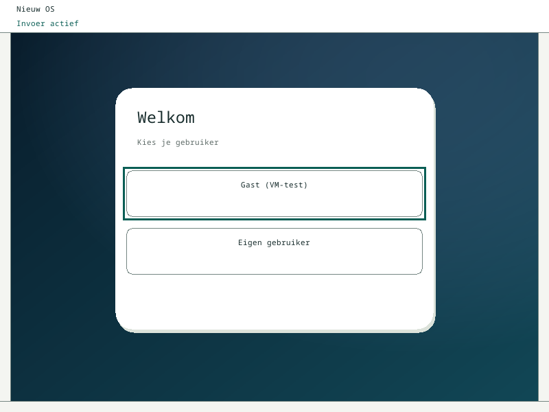
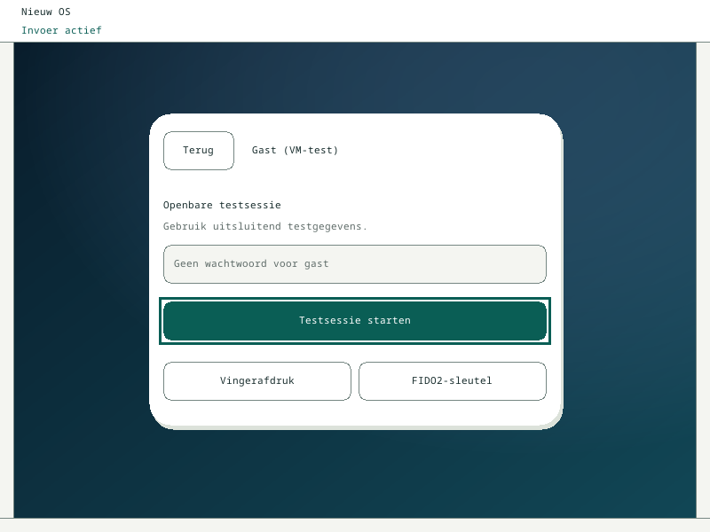
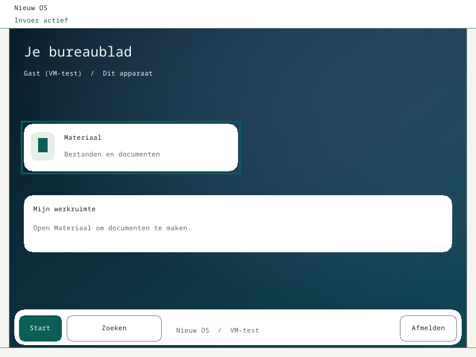

# Native aanmeldroute, bureaublad en QEMU — 2 november 2026

De eigen OS-code heeft een opt-in, native VM-sessieroute. De eindproef op
implementatiecommit `344dc0afde893784503217ac676e154b13662507` slaagt met echte
QMP-invoer en alle pixels in het appgebied `(16,48,768,536)` gelijk aan de
brongebonden hostrenderer. Geen pixelmaskers binnen het appgebied. De persoonlijke
accountpoging gebruikt uitsluitend synthetische `test`-invoer, wordt geweigerd
en wist de invoer; alleen de expliciet gekozen openbare gast opent de desktop.
Dit bewijst geen echte accountauthenticatie, key-unlock, compositor-lock of release.

## Bron en bewijs

- Source-v3: `05b047819f1c1cddce6868034ab2208d8a35a95d9f974860afb8bbc53eeb8658`.
- [Eindrapport](final-native.json), [ruwe seriële bytes](final-native-serial.txt).
- [Vijfstappenbasis zonder batches](before-batching.json), bron `7648a8f`.
- [Acht stappen met compositorbatch](compositor-batching.json), bron `51d883e`.
- [Lokale Windowsrapportage](local-pc-reported.json): door de geautoriseerde
  lokale Codex-chat aangeleverde resultaten; ruwe Windowsdata staat op die pc.
- [Frontendhost/scalarcontrole](../../../ui/native/verification/checks.json)
  bindt de tien werkelijk gescande archives, compiler en frontendbronnen.
- [Compositorbatchreview](../perf-batch-review.md) en
  [interactieve appbatchreview](../perf-interactive-review.md).

`final-native.json` bevat de exacte commandoregel, machine/QEMU-/firmware-/
loader-/kernel-/oracle-/schermhashes en fasegrenzen. De volledige QMP-trace,
PPM's, fixture en wegwerpimages staan in de daarin genoemde buildmap; de
compacte rapporten binden de ruwe result.json met SHA256. Geen VM-binaries of
schijfimages zijn in Git opgenomen. De PNG's hieronder zijn lossloze conversies
van de echte finale QEMU-screendumps, geen browsermock of gegenereerde illustratie.
De oracle vergelijkt uitsluitend het toegewezen appgebied; de systeemrand is
ook visueel bekeken en is neutraal 'Nieuw OS / Invoer actief'.





## Uitgevoerde controles

Alle onderstaande eindcontroles zijn geslaagd, exit0:

| Controle | Uitkomst en grens |
|---|---|
| `python3 -B tools/preflight.py --strict` | Toolchain/targets/firmware aanwezig; geen hardwareacceptatie |
| `python3 -B ui/native/verify.py` | 46 hosttests, Clippy/fmt, x86_64-unknown-none scalar-build en volledige objectscan van 10 archives |
| `cargo +1.90.0 test --offline --locked --manifest-path sdk/examples/materiaal/Cargo.toml` | 27 hosttests, waaronder begrensde input/save/paintbatch, ACK-verlies, inputverlies en actuele complete generatie |
| `cargo +1.90.0 test --offline --locked --manifest-path sdk/examples/compositor/Cargo.toml` | 15 hosttests; daarnaast native crossbuild/ELFinspectie |
| `python3 -B -m unittest tests.test_common tools.tests.test_package_windows_qemu tools.tests.test_materiaal_preview tools.tests.test_materiaal_probe` | 72 Pythonchecks; sourcevolgorde-regressie was eerst rood en daarna groen |
| `Test-Acceleration.ps1` | 33 synthetische selectie-/QMP-parser-/handshakegevallen op PowerShell7/Linux; geen WHPX-runtimebewijs |
| `Test-Launcher.ps1 -QemuPath <fake-qemu>` | 6 integriteitscontroles met synthetische bestanden; geen gastcode |
| `tools/build.py --kernel-feature native-system-session-preview` | Werkelijke loader, kernel en zeven geïsoleerde executables gebouwd/geïnspecteerd |
| `tools/run_session_preview.py … --machine pc-q35-10.0 --timeout 240` | Alle acht native fases, bron-/artifact-/fixture-/QEMU-hercontrole en rawQEMUexit0 |

De oorspronkelijke verifier eindigde ten onrechte rood op een oude telling
van 9 archives; de al bestaande SDK-afhankelijkheid zeroize maakt de werkelijke
graph 10. De herstelde gate eist exact alle tien namen en scant ze allemaal;
geen instruction-, feature-, source- of dependencycontrole is weggelaten.

Volledige commandologs van deze uitvoering staan onder
`build/logs/native-materiaal/` en `/workspace/scratch/session-final-*.txt`.
Root draait Rust 1.90.0. Hostscenario's bewijzen geen fysieke hardware of
productiegeschikte beveiliging; de native QEMU-proef is een aparte bewijslaag.

## Metingen in deze cloudomgeving

TCG, QEMU 10.0.13, q35-10.0, qemu64,1vCPU,256 MiB, headless en een gedeelde
240s-deadline. Eén proef per bron; geen gemiddelde of p95 uit één sample.

| Bron | Wijziging | Route | Totale tijd | Materiaalovergang |
|---|---|---|---:|---:|
|7648a8f|Een verzoek/tegel per beurt|5fases|162,47s|33,94s|
|51d883e|Max8compositorberichten|8fases|164,03s|21,63s|
|344dc0a|Daarnaast max4tegels/inputpass|Dezelfde8fases|118,79s|16,08s|

De Materialapp-pixels zijn in alle drie proeven bytegelijk. De systeemrand
werd vóór51d neutraal gemaakt; de laatste twee proeven hebben ook bytegelijke
volledige Materialscreenshots. De eerste en tweede totale tijd vergelijken
verschillende routes en mogen niet als een versnelling van dezelfde taak
worden voorgesteld. Variatie en hostbelasting blijven mogelijke factoren.
Volledige schermopbouw is nog zichtbaar traag; dirty regions/buffertransport en
uiteindelijk GPU-drivers zijn vervolgwerk. Meer vCPU's toevoegen is niet veilig
als vervanging voor nog niet aangetoonde SMP-ondersteuning.

## Reproduceren en Windows

Gebruik de bestaande lokale toolchainomgeving uit DEVELOPMENT.md. Alle
runners gebruiken uitsluitend eigen wegwerpimages, geen fysieke disks.

```sh
NOS_BUILD_DIR=build/session-preview NOS_TARGET_DIR=target/session-preview \
  python3 -B tools/build.py --kernel-feature native-system-session-preview
NOS_BUILD_DIR=build/session-preview NOS_TARGET_DIR=target/session-preview \
  python3 -B tools/run_session_preview.py --build-dir build/session-preview \
  --bios-rom /pad/naar/bios-256k.bin --vga-rom /pad/naar/vgabios-stdvga.bin \
  --machine pc-q35-10.0 --timeout 240
```

De fixture wordt automatisch met de echte Rust-renderer gegenereerd; dat is
hostoutput en wordt pas in de echte VM vergeleken. `--machine` moet het
werkelijk geïnstalleerde, expliciet ondersteunde profiel zijn. Tests nemen
geen andere machine of oracle stilzwijgend over.

De bestaande `tools/package_windows_qemu.py` accepteert het nieuwe profiel,
bindt alle zeven ELF's, bewaart het exacte kernelprofiel en neemt de gehashte
QMPhelper mee. Gebruik de bestaande firmware-/licentieroute uit
`tools/windows-qemu/README.md`; er is geen tweede packager. De lokale Codex-chat
bouwt in een schone WSL-checkout en test buiten OneDrive, omdat synchronisatie
anders hardlinks kan toevoegen. Integriteitscontroles blijven ongewijzigd.

De bytegelijke QMPhelper SHA256
`fc506bb5ed327491a48316c9e9195418e3b08d090ceacdd4119a65c910c2defc`
is 6/6 op de echte Windows-pc geslaagd (PS 5.1 enPS 7.6). De 51d-nativebaseline
slaagde6/6 (3WHPX/3TCG). Finale344dc0a- en SDL-resultaten worden apart aan
het lokale rapport toegevoegd zodra aangeleverd; deze cloudproef bewijst die niet.

## Resterend en terugval

FR-S01/S02/U01–U05 blijven open. De score blijft 34/100. Er is nog geen
beveiligde gebruikersdatabase, echte credentialverifier, enroll-/herstelroute,
limitering, auth-/sessieservice, keyring-unlock, compositor/input-lock,
multisessie-intrekking of werkende biometrie/FIDO2. De openbare gast blijft
hetzelfde synthetische appdomein met vooraf verleende VM-rechten. De UI mag
niet met productiegegevens of echte wachtwoorden als beveiligd OS worden gebruikt.

Voor terugval naar de bestaande directe Materiaal-proef bouw je profiel
`native-system-materiaal`. Voor de volledige oude bron maak je een nieuwe,
geïsoleerde checkout op basiscommit e08fb0e; reset geen bestaande dirty checkout.
De wijzigingen zijn niet naar main gemerged en installeren niets op echte hardware.
